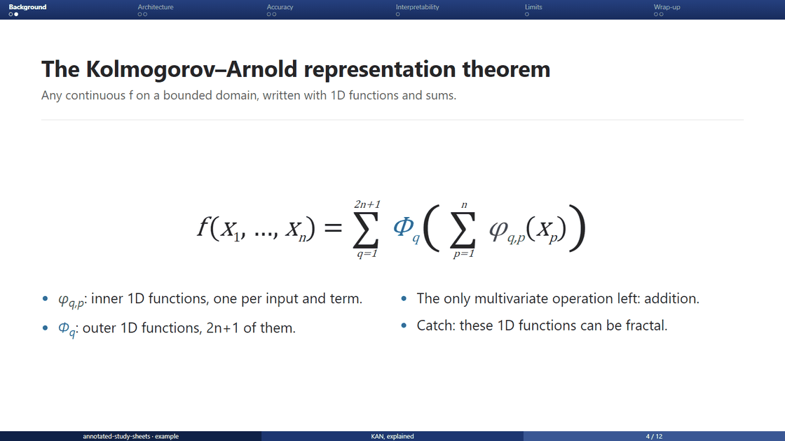
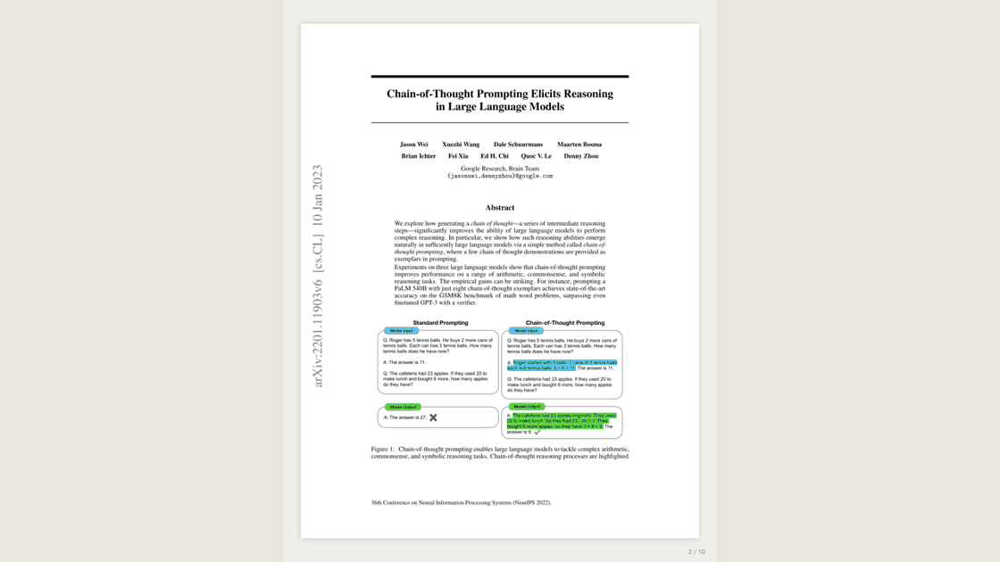
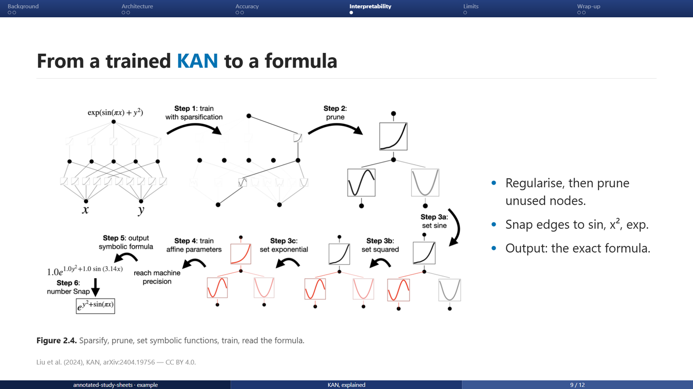
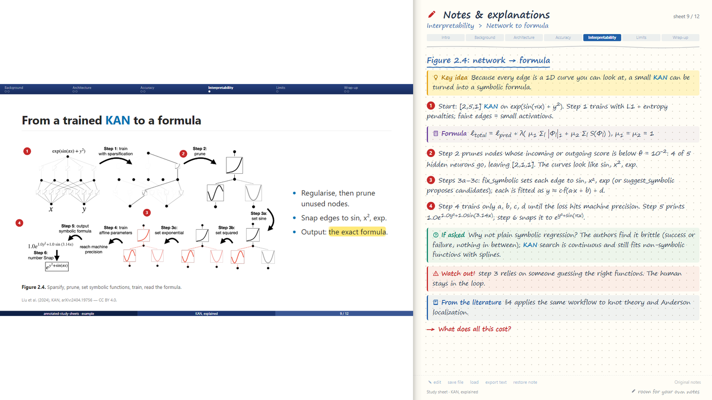
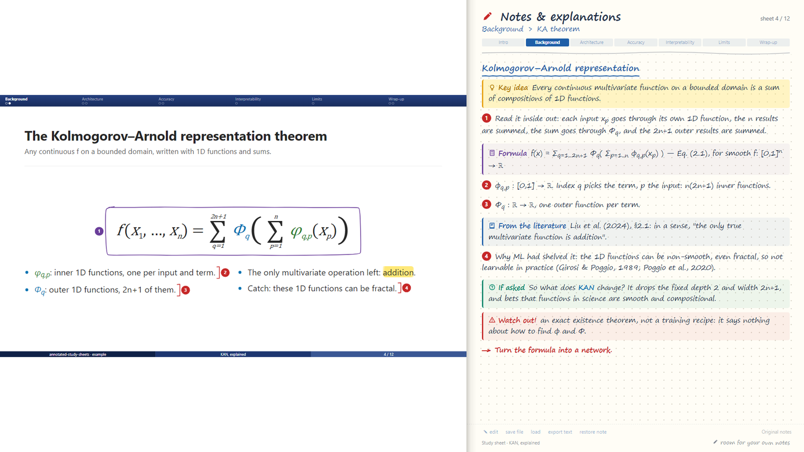

<div align="center">

# ✎ Annotated Study Sheets — a Claude Code Skill

[](#install)
[](skills/annotated-study-sheets/SKILL.md)
[](LICENSE)
[](skills/annotated-study-sheets/assets)

**A skill for Claude Code (and any agent that reads `SKILL.md`) that turns any paper, PDF or slide deck into a hand-annotated study sheet,**
**and builds offline HTML talks where one key — `N` — reveals the study sheet behind every slide.**

Install the skill, ask *“annotate this paper”* or *“make me a study deck about…”*, open the HTML. That's it.

[**▶ Live demo: study deck**](https://rodrigopascual.github.io/annotated-study-sheets/examples/kan-explained/#5) ·
[**▶ Live demo: annotated paper**](https://rodrigopascual.github.io/annotated-study-sheets/examples/chain-of-thought/#2) ·
[Install](#install) · [How it works](#how-it-works)



</div>

---

**Annotated Study Sheets** is an open-source **Claude Code skill** (Agent Skill) that helps you **study papers, PDFs, lecture
slides and web pages with AI**: it produces an **annotated study guide** with numbered marks on the original and
handwritten-style explanations, and it builds **offline HTML presentations with speaker notes** — a lightweight,
dependency-free alternative to reveal.js or Beamer for talks you also want to *study from*.

## Why

Slides are made to be *seen*; papers are made to be *read once*. Neither is made to be **studied**.
This skill gives every page or slide a second layer: the explanation a good teacher would scribble in the margin.

- **Numbered pencil marks** on the parts that matter — brackets beside text, boxes around equations, badges on figure panels.
- **A study sheet** on dotted paper, in handwriting, that *writes itself in* block by block: key idea, explanations,
  formulas, sources, “if asked” answers, pitfalls.
- **Hover a note → a pencil arrow** points at the exact element it explains.
- **Two versions in one file**: clean for the audience, annotated for you. Toggle with **N**.

## Two things it makes

### 1 · Annotated documents — papers, PDFs, web pages, existing slides

> *“Annotate this paper so I can study it.”*

The agent renders the pages, finds the regions that carry the argument (abstract claim, key equations, figures, tables)
and explains each one on the sheet. Example: the real **Chain-of-Thought Prompting** paper (Wei et al., 2022), 10 annotated
sheets over its first 6 pages, from abstract to ablations — [open the demo](https://rodrigopascual.github.io/annotated-study-sheets/examples/chain-of-thought/#2).



### 2 · Study decks — new presentations with built-in speaker notes

> *“Make a talk explaining the KAN paper, with study notes.”*

Short, clean slides for the room; the depth lives in the sheet. Beamer-style section bar, presenter view, overview,
figure zoom, editable notes. Example: **KAN: Kolmogorov-Arnold Networks** (Liu et al., 2024) explained in 12 slides with the
paper's own figures — [open the demo](https://rodrigopascual.github.io/annotated-study-sheets/examples/kan-explained/#5).

| Clean (what the audience sees) | Annotated (press **N**) |
|---|---|
|  |  |



## Install

**Claude Code** (plugin marketplace):

```
/plugin marketplace add RodrigoPascual/annotated-study-sheets
/plugin install annotated-study-sheets@annotated-study-sheets
```

**Any agent that reads `SKILL.md` files** (Claude Code, Codex, Cursor, …) — copy the skill folder:

```bash
git clone https://github.com/RodrigoPascual/annotated-study-sheets
cp -r annotated-study-sheets/skills/annotated-study-sheets ~/.claude/skills/
```

**Claude.ai / Claude Desktop** — zip `skills/annotated-study-sheets` and upload it under *Settings → Capabilities → Skills*.

Annotating PDFs also needs `pip install pymupdf`.

## Use

Just ask:

- *“Annotate `attention.pdf` as a study sheet.”*
- *“Explain these slides (`lecture3.pdf`) slide by slide, with marks on each figure.”*
- *“Turn this blog post into an annotated study sheet.”*
- *“Build a 12-slide deck about photosynthesis for 15-year-olds, with study notes.”*
- *“Add study notes to every slide of my talk in `talk/index.html`.”*

Your files are never modified: annotating `paper.pdf` creates a new `paper-annotated/` folder next to it.

Open the resulting `index.html` (double click). Keys:

| Key | Action |
|---|---|
| **N** | study sheet on / off |
| **E** | edit the notes of this slide (saved in the browser; **Ctrl+S** saves `notes.js`) |
| **P** | presenter view: current + next slide, notes, timer |
| **O** | overview of all slides |
| → / ← | next / previous (builds included) · `12` + Enter jumps to slide 12 |
| click a figure | zoom and pan |
| **?** | all shortcuts |

`index.html?notes#7` opens slide 7 with the sheet already open.

## How it works

The notes are plain text inside each slide, so they are easy for an agent to write and for you to edit:

```html
<section class="slide" data-section="The rule" data-title="The update rule">
  <h2>The whole algorithm is one line</h2>
  <div class="eq" data-n="1" data-mark="formula">w ← w − η · ∇L(w)</div>
  <ul><li data-n="2">η: the learning rate, <span class="hl">the size of the step</span>.</li></ul>
  <aside class="notes">
    # The update rule
    ! New weights = old weights minus a small step against the gradient.
    (1) Read it right to left: compute the slope, scale it by η, subtract it.
    f: w_{t+1} = w_{t} − η · ∇L(w_{t})
    (2) η is chosen by us, not learned.
    ?? Why not jump straight to the minimum? We only know the local slope.
    → How big should the step be?
  </aside>
</section>
```

| Notes line | Becomes |
|---|---|
| `# …` | sheet title, hand-underlined |
| `! …` | **Key idea** box |
| `(1) …` | block with red badge 1, linked to `data-n="1"` on the slide |
| `> …` | **From the literature** box |
| `?? …` | **If asked** box |
| `warn:` `ex:` `f:` | **Watch out!**, **Example**, **Formula** boxes |
| `\| a \| b \|` | small table |
| `→ …` | what comes next |

Images and PDF pages get marks with `data-zones="1:x0,y0,x1,y1; 2:…:formula"` (percent of the image).
Full reference: [`notes-syntax.md`](skills/annotated-study-sheets/references/notes-syntax.md) ·
[`slide-layouts.md`](skills/annotated-study-sheets/references/slide-layouts.md) ·
[`annotate-documents.md`](skills/annotated-study-sheets/references/annotate-documents.md).

## What's inside

```
skills/annotated-study-sheets/
├── SKILL.md                    # what the agent reads: workflow + writing guidelines
├── assets/
│   ├── study.js / study.css    # the engine (~1,200 lines, no dependencies)
│   ├── deck-template.html      # starting point for a new deck
│   └── document-template.html  # starting point for an annotated document
├── scripts/new_study.py        # starts a project: copies the engine byte for byte + template
├── scripts/pdf_to_pages.py     # PDF → page images (+ text-block positions for the zones)
└── references/                 # notes syntax, layouts, annotating documents
examples/
├── kan-explained/              # 12-slide study deck on “KAN: Kolmogorov-Arnold Networks”
└── chain-of-thought/           # the “Chain-of-Thought Prompting” paper, annotated
```

Everything is English by default; set `window.STUDY = { lang: 'es' }` for Spanish labels (more languages welcome).

## Contributing

Issues and PRs are welcome — new languages for the UI labels, slide layouts, examples in other fields, and better
heuristics for placing marks on PDFs. Please keep the engine dependency-free.

If this helped you study or present, a ⭐ helps others find it.

## License

Code: [MIT](LICENSE) © Rodrigo Pascual-García.
Examples reproduce pages and figures of two CC BY 4.0 papers, with attribution:
Wei et al. (2022), [arXiv:2201.11903](https://arxiv.org/abs/2201.11903) · Liu et al. (2024), [arXiv:2404.19756](https://arxiv.org/abs/2404.19756).
See each example's `ATTRIBUTION.md`. The authors do not endorse this project.
