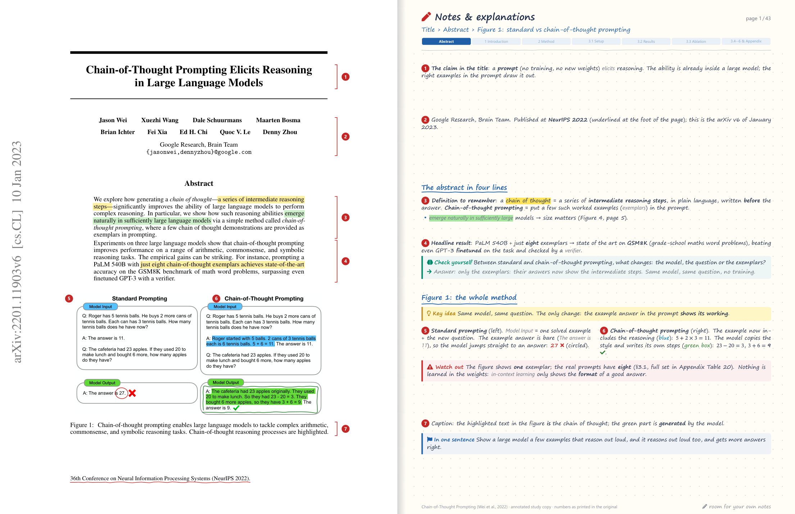
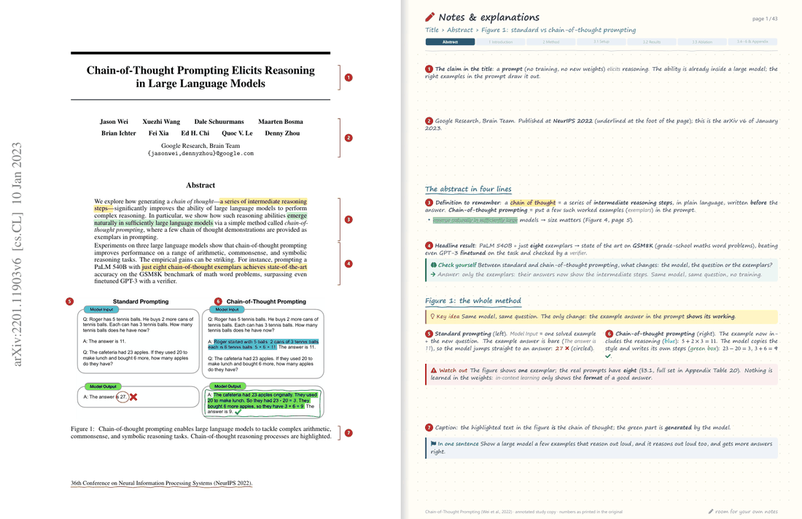
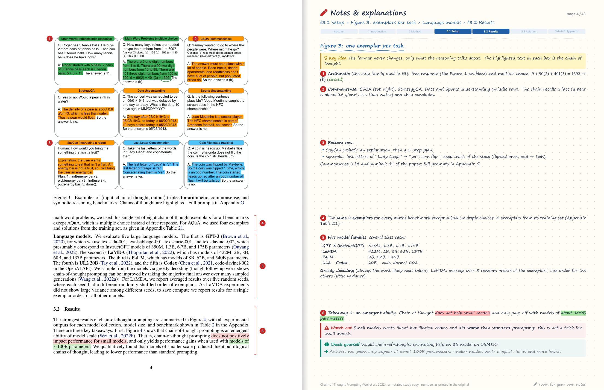
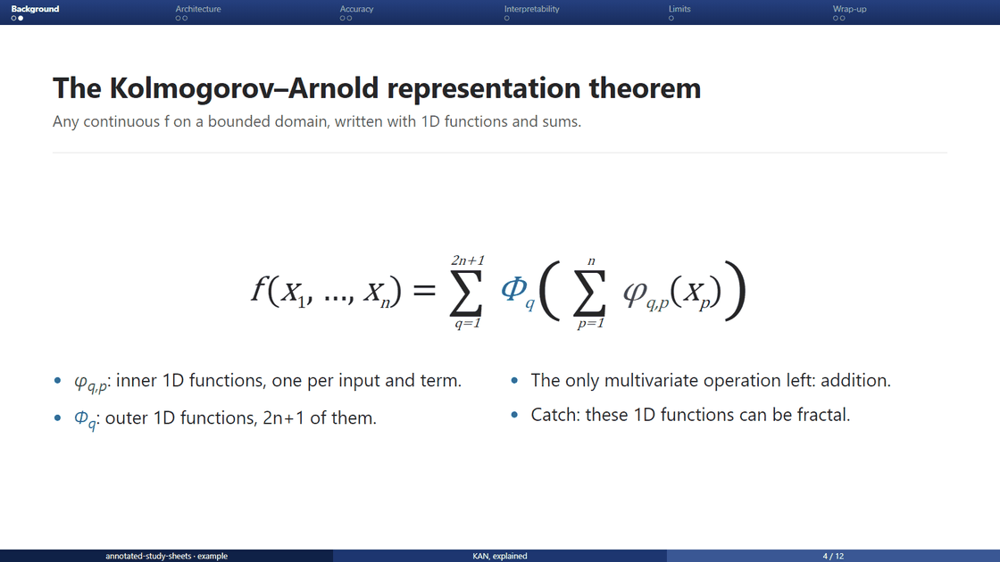
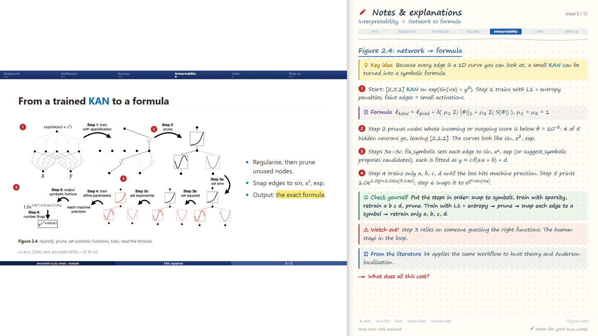

<div align="center">

# ✎ Annotated Study Sheets — a Claude Code Skill

[](#install)
[](skills/annotated-study-sheets/SKILL.md)
[](LICENSE)
[](#two-things-it-makes)

**A skill for Claude Code (and any agent that reads `SKILL.md`) that turns any paper or PDF into an annotated study copy —**
**every original page beside a handwritten notes page, with pencil marks on the original — and builds offline HTML talks**
**where one key, `N`, reveals the study sheet behind every slide.**

Install the skill, ask *“annotate this paper”* or *“make me a study deck about…”*. That's it.

[**▶ Example: annotated paper (PDF)**](https://rodrigopascual.github.io/annotated-study-sheets/examples/chain-of-thought-annotated/chain-of-thought-annotated.pdf) ·
[**▶ Live demo: study deck**](https://rodrigopascual.github.io/annotated-study-sheets/examples/kan-explained/#5) ·
[Install](#install) · [How it works](#how-it-works)



</div>

---

**Annotated Study Sheets** is an open-source **Claude Code skill** (Agent Skill) that helps you **study papers, PDFs, lecture
slides and reports with AI**: it produces an **annotated PDF study guide** (the original pages, untouched, each beside a
page of handwritten-style explanations, with numbered marks on the original), and it builds **offline HTML presentations
with speaker notes** — a lightweight alternative to reveal.js or Beamer for talks you also want to *study from*.

## Why

Slides are made to be *seen*; papers are made to be *read once*. Neither is made to be **studied**.
This skill gives every page or slide a second layer: the explanation a good teacher would scribble in the margin.

- **Numbered pencil marks** on the parts that matter — brackets beside paragraphs, boxes around equations, badges on
  figure panels, highlighter on the 2–4 phrases to remember.
- **A notes page** on dotted paper, in handwriting, **level with what it explains**: key idea, formulas symbol by symbol,
  how to read each figure and table, a “check yourself” question per page, pitfalls — and white space for your own notes.
- **The original is never touched**: `paper.pdf` → a new `paper-annotated/paper-annotated.pdf`.
- **Decks**: two versions in one file, clean for the audience, annotated for you. Toggle with **N**.

## Two things it makes

### 1 · Annotated PDFs — papers, articles, reports, slides exported to PDF

> *“Annotate this paper so I can study it.”*

The agent copies the PDF, reads it whole, and builds a **new PDF where each page is a spread**: the original page on the
left with numbered pencil marks, and a notes page on the right that explains every paragraph group, figure panel, table
and equation, in the page's own order. A second file has the same pages one after the other, for A4 printing.
Example: the real **Chain-of-Thought Prompting** paper (Wei et al., 2022), pages 1–6 —
[open the annotated PDF](https://rodrigopascual.github.io/annotated-study-sheets/examples/chain-of-thought-annotated/chain-of-thought-annotated.pdf).





### 2 · Study decks — new presentations with built-in speaker notes

> *“Make a talk explaining the KAN paper, with study notes.”*

Short, clean slides for the room; the depth lives in the sheet. Beamer-style section bar, presenter view, overview,
figure zoom, editable notes. Example: **KAN: Kolmogorov-Arnold Networks** (Liu et al., 2024) explained in 12 slides with the
paper's own figures — [open the demo](https://rodrigopascual.github.io/annotated-study-sheets/examples/kan-explained/#5).



| Clean (what the audience sees) | Annotated (press **N**) |
|---|---|
|  |  |

## Install

**Claude Code** (plugin marketplace):

```
/plugin marketplace add RodrigoPascual/annotated-study-sheets
/plugin install annotated-study-sheets@annotated-study-sheets
```

**Any agent that reads `SKILL.md` files** (Claude Code, Codex, Cursor, …) — copy the skill folder:

```bash
git clone https://github.com/RodrigoPascual/annotated-study-sheets
cp -r annotated-study-sheets/skills/annotated-study-sheets ~/.claude/skills/
```

**Claude.ai / Claude Desktop** — zip `skills/annotated-study-sheets` and upload it under *Settings → Capabilities → Skills*.

Annotated PDFs need `pip install pymupdf` and LuaLaTeX ([TeX Live](https://tug.org/texlive/), or MiKTeX on Windows).
Study decks need nothing.

**ChatGPT, Gemini or any chatbot (no install)** — chatbots that only get a link cannot run the scripts, and if they
write their own CSS the result looks nothing like the screenshots. For a **study deck**, paste this prompt:

```text
Make a study deck about <topic> with the "annotated-study-sheets" skill
(https://github.com/RodrigoPascual/annotated-study-sheets). Follow AGENTS.md in that repo exactly:
- Do NOT write any CSS or JavaScript. Start from skills/annotated-study-sheets/assets/deck-template.html, which loads
  the engine (study.css + study.js) from the jsDelivr CDN, and only fill in the <section class="slide"> elements,
  the data-n marks and the <aside class="notes"> written in references/notes-syntax.md.
```

For an **annotated PDF**, a chatbot can write the `notes/pNN.tex` files, but the PDF is compiled on your computer with
`annotate_pdf.py build` (it needs LuaLaTeX).

## Use

Just ask:

- *“Annotate `attention.pdf` so I can study it.”*
- *“Explain these slides (`lecture3.pdf`) page by page, with marks on each figure, in Spanish.”*
- *“Make an annotated copy of my report, pages 1–10.”*
- *“Build a 12-slide deck about photosynthesis for 15-year-olds, with study notes.”*
- *“Add study notes to every slide of my talk in `talk/index.html`.”*

Your files are never modified: annotating `paper.pdf` creates a new `paper-annotated/` folder next to it, with
`paper-annotated.pdf` (spreads: original | notes) and `paper-annotated-two-page.pdf` (original, notes, … for printing).

For a study deck, open the resulting `index.html` (double click). Keys:

| Key | Action |
|---|---|
| **N** | study sheet on / off |
| **E** | edit the notes of this slide (saved in the browser; **Ctrl+S** saves `notes.js`) |
| **P** | presenter view: current + next slide, notes, timer |
| **O** | overview of all slides |
| → / ← | next / previous (builds included) · `12` + Enter jumps to slide 12 |
| click a figure | zoom and pan |
| **?** | all shortcuts |

`index.html?notes#7` opens slide 7 with the sheet already open.

## How it works

**Annotated PDF.** `annotate_pdf.py init paper.pdf` makes the copy and one notes file per page; `anchors` prints where
everything is on a page (mm from its top-left corner); the agent writes the notes; `build` compiles with LuaLaTeX and
checks for overflow. A notes file is short and readable:

```latex
\crumbs{§3 Method \,›\, Equation~2}
\bracket{1}{40.8}{86.5}                       % bracket + badge 1 beside a paragraph group
\highlight{66.2}{32.4}{147.5}{36.0}           % highlighter on a key phrase
\pencilbox[maths]{22.5}{96.9}{109.8}{103.3}   % hand-drawn box around an equation

\block[y=40]{\num{1}\ \textbf{What it says}: plain words, then why it matters.}
\block[y=96]{\begin{formula}[Eq.~(2)] each symbol, the intuition, a toy example \end{formula}}
```

Full reference: [`annotate-pdf.md`](skills/annotated-study-sheets/references/annotate-pdf.md).

**Study deck.** The notes are plain text inside each slide, so they are easy for an agent to write and for you to edit:

```html
<section class="slide" data-section="The rule" data-title="The update rule">
  <h2>The whole algorithm is one line</h2>
  <div class="eq" data-n="1" data-mark="formula">w ← w − η · ∇L(w)</div>
  <ul><li data-n="2">η: the learning rate, <span class="hl">the size of the step</span>.</li></ul>
  <aside class="notes">
    # The update rule
    ! New weights = old weights minus a small step against the gradient.
    (1) Read it right to left: compute the slope, scale it by η, subtract it.
    f: w_{t+1} = w_{t} − η · ∇L(w_{t})
    (2) η is chosen by us, not learned.
    ?? The loss jumps up and down and never settles. What do you change? Make η smaller: the steps overshoot.
    → How big should the step be?
  </aside>
</section>
```

| Notes line | Becomes |
|---|---|
| `# …` | sheet title, hand-underlined |
| `! …` | **Key idea** box |
| `(1) …` | block with red badge 1, linked to `data-n="1"` on the slide |
| `> …` | **From the literature** box |
| `?? Question? Answer.` | **Check yourself** box (answer hidden until clicked) |
| `warn:` `ex:` `f:` | **Watch out!**, **Example**, **Formula** boxes |
| `\| a \| b \|` | small table |
| `→ …` | what comes next |

Full reference: [`notes-syntax.md`](skills/annotated-study-sheets/references/notes-syntax.md) ·
[`slide-layouts.md`](skills/annotated-study-sheets/references/slide-layouts.md).

## What's inside

```
skills/annotated-study-sheets/
├── SKILL.md                     # what the agent reads: workflows + writing guidelines
├── assets/
│   ├── pdf/studysheet.sty       # annotated-PDF engine (LuaLaTeX): spreads, marks, notes boxes
│   ├── study.js / study.css     # study-deck engine (no dependencies)
│   └── deck-template.html       # starting point for a new deck
├── scripts/annotate_pdf.py      # PDF → <name>-annotated/: init, anchors, build (+ checks)
├── scripts/new_study.py         # starts a deck: copies the engine byte for byte + template
└── references/                  # annotate-pdf, notes syntax, slide layouts
examples/
├── chain-of-thought-annotated/  # the “Chain-of-Thought Prompting” paper → annotated PDF (pages 1–6)
└── kan-explained/               # 12-slide study deck on “KAN: Kolmogorov-Arnold Networks”
```

Everything is English by default; `annotate_pdf.py init --lang es` and `window.STUDY = { lang: 'es' }` give Spanish
labels (more languages welcome).

## Contributing

Issues and PRs are welcome — new languages for the labels, slide layouts, examples in other fields, and better
heuristics for placing marks on PDFs. Please keep the deck engine dependency-free.

If this helped you study or present, a ⭐ helps others find it.

## License

Code: [MIT](LICENSE) © Rodrigo Pascual-García.
Examples reproduce pages and figures of two CC BY 4.0 papers, with attribution:
Wei et al. (2022), [arXiv:2201.11903](https://arxiv.org/abs/2201.11903) · Liu et al. (2024), [arXiv:2404.19756](https://arxiv.org/abs/2404.19756).
See each example's `ATTRIBUTION.md`. The authors do not endorse this project.
